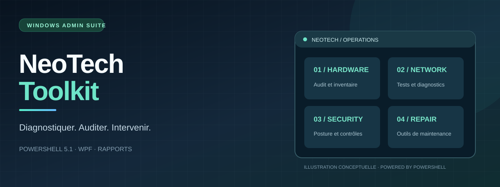

<div align="center">



# NeoTech Toolkit

**Boîte à outils d'administration et de diagnostic Windows, en PowerShell.**

Console + WPF · Scripts portables · PowerShell 5.1 intégré à Windows

[Installation](#installation) · [Utilisation](#utilisation) · [Modules](#modules) · [Build EXE](#build-exe) · [Signer](#signature-authenticode)

</div>

---

## À propos

NeoTech Toolkit est un outil tout-en-un pour les admins et techniciens Windows. Il remplace 10+ scripts éparpillés par un exécutable unique, portable, qui fait l'audit matériel, la诊断 réseau, la posture de sécurité, l'inventaire logiciel, la réparation système et l'export de rapport.

Conçu pour les interventions Windows : lancement depuis les scripts fournis, exécution depuis une clé USB possible et compilation en `.exe` proposée séparément via `ps2exe`. Les signatures auto-signées nécessitent une relation de confiance locale.

## Aperçu

*Vue textuelle illustrative des catégories. Les captures réelles de la GUI restent à fournir.*

```
┌──────────────────────────────────────────────────────────────────────┐
│ NEOTECH TOOLKIT  v1.0.0  -  Administration & Diagnostic Windows         │
├──────────────────────────────────────────────────────────────────────┤
│                                                                      │
│  ⚙  Audit Matériel    CPU, RAM, stockage, pilotes                  │
│  🌐 Réseau             Audit, réparation, ports en écoute            │
│  🔒 Sécurité           TPM, Defender, BitLocker, UAC, comptes        │
│  📦 Logiciels          Installés, Windows Update, démarrage          │
│  🔧 Réparation         SFC, DISM, reset WU, nettoyage temp          │
│  ⚙ Outils admin         MMC, CPL, registre, services                 │
│  📄 Rapport            Export TXT + HTML horodaté                    │
│                                                                      │
└──────────────────────────────────────────────────────────────────────┘
```

**Deux interfaces** :

| Console | GUI (WPF) |
|---|---|
| `NeoTech Toolkit.bat` | `NeoTech Toolkit.bat` (défaut) |
| `NeoTech Toolkit.bat CONSOLE` | — |
| 130×42, ANSI colors, Unicode box-drawing | Thème sombre moderne, sidebar 7 catégories |

## Captures

> *À venir : captures d'écran de la console et de la GUI.*

## Installation

### Récupérer les sources

1. Téléchargez le [ZIP du dépôt](https://github.com/neosoda/NeoTech-Toolkit/archive/refs/heads/master.zip) ou clonez-le ci-dessous.
2. Décompressez-le dans un dossier local (par exemple `C:\Tools\NeoTech`).
3. Lancez `NeoTech Toolkit.bat`.

**Distribution EXE :** ce README ne promet pas de binaire prêt à télécharger : aucune release publiée n’a été vérifiée. La compilation est décrite dans [Build EXE](#build-exe).

### Depuis le repo

```bash
git clone https://github.com/neosoda/NeoTech-Toolkit.git
cd NeoTech-Toolkit
.\NeoTech Toolkit.bat
```

> **Prérequis** : Windows 10+ · PowerShell 5.1+ (intégré) · Droits admin pour la section sécurité/réseau

## Signature Authenticode

Tous les scripts `.ps1` et `.psm1` sont signés avec un certificat auto-signé. Pour que Windows fasse confiance au toolkit sans alerte SmartScreen :

```powershell
# Une seule fois, en admin :
.\Tools\Install-TrustedPublisher.ps1
```

Cette procédure configure une confiance **locale** envers un certificat auto-signé ; elle ne fournit ni signature par une autorité publique ni réputation Microsoft SmartScreen. N’installez cette confiance que si vous maîtrisez l’origine des scripts.

## Utilisation

### Menu interactif

```cmd
NeoTech Toolkit.bat          REM GUI (defaut)
NeoTech Toolkit.bat CONSOLE  REM Console texte
```

Les deux interfaces exposent les mêmes 7 catégories, accessibles par sous-menus.

### Mode CLI / automatisation

```powershell
# Rapport complet (TXT + HTML sur le bureau)
.\NeoTech-Toolkit.ps1 -ReportOnly

# Sections spécifiques
.\NeoTech-Toolkit.ps1 -ReportOnly -Sections Overview,Hardware,Network

# Tâche planifiée (headless)
.\NeoTech-Toolkit.ps1 -ReportOnly -Headless
```

### Logs

Tout est tracé dans `Logs\NeoTech_<MACHINE>.log` (UTF-8, rotation à 2 MB).

```
[2026-09-05 14:23:15.123] [Info] [Main] Demarrage NeoTech Toolkit (admin OK)
[2026-09-05 14:23:18.456] [Warning] [Network] TIMEOUT (5s) : Test google.com
[2026-09-05 14:23:25.012] [Error] [Security] Acces refuse a gpresult
```

## Modules

| Module | Rôle | Fonctions |
|---|---|---|
| `NTCommon` | Helpers partagés | logs, formatting, élévation, timeouts, GUI helpers |
| `NTAudit` | Audit matériel | OS, hardware, pilotes, logiciels, Windows Update |
| `NTNetwork` | Réseau | audit, réparation, ports en écoute (avec timeouts) |
| `NTStorage` | Stockage | volumes, SMART, espace disque, temp |
| `NTSecurity` | Sécurité | TPM, Defender, BitLocker, UAC, firewall, comptes, GPO |
| `NTPower` | Alimentation | batterie, plans d'alimentation |
| `NTStartup` | Démarrage | Run, Startup, tâches planifiées |
| `NTPerformance` | Perf | processus, services, events, snapshot |
| `NTRepair` | Réparation | SFC, DISM, reset WU, health check |
| `NTReport` | Rapport | export TXT + HTML |
| `NTGUI` | Interface | WPF, XAML, sidebar, capture de sortie |

## Build EXE

Pour compiler en `.exe` unique (autonome, signé, demande UAC au lancement) :

```powershell
# Installer ps2exe (une seule fois)
Install-Module ps2exe -Scope CurrentUser

# Compiler
.\Tools\Build-EXE.ps1
```

Le `.exe` est dans `Tools\NeoTech-Toolkit.exe`. Aucune dépendance, intégrable dans un RMM, distribuable en pièce jointe.

## Architecture

```
NeoTechToolkit\
├── NeoTech Toolkit.bat              # Lanceur Windows
├── NeoTech-Toolkit.ps1              # Entry point console
├── NeoTech-Toolkit-GUI.ps1          # Entry point GUI
├── README.md
├── Modules\
│   ├── NTCommon.psm1                # Helpers partages
│   ├── NTAudit.psm1
│   ├── NTNetwork.psm1
│   ├── NTStorage.psm1
│   ├── NTSecurity.psm1
│   ├── NTPower.psm1
│   ├── NTStartup.psm1
│   ├── NTPerformance.psm1
│   ├── NTRepair.psm1
│   ├── NTReport.psm1
│   └── NTGUI.psm1
├── Tools\
│   ├── Sign-NeoTech.ps1             # Genere le cert + signe les scripts
│   ├── Install-TrustedPublisher.ps1 # Importe le cert en TrustedPeople
│   └── Build-EXE.ps1                # Compile en .exe via ps2exe
└── Logs\                            # Logs runtime (rotation 2 MB)
```

## Signer ses propres scripts

```powershell
# 1. Generer le cert (une seule fois, RSA-2048 / SHA-256 / 5 ans)
.\Tools\Sign-NeoTech.ps1

# 2. Signer tous les .ps1 / .psm1
# (fait automatiquement par Sign-NeoTech.ps1)
```

## Robustesse

Chaque fonction applique trois principes :

1. **Try/catch défensif** sur tous les accès CIM/WMI (propriétés inexistantes sur certains OS)
2. **`Invoke-NTWithTimeout`** sur les opérations réseau (`Test-NetConnection`, `netsh`, `ipconfig`) pour éviter les blocages
3. **Logs en cas d'échec** : timeout, exception, accès refusé → message clair à l'utilisateur + ligne dans le log

Exemple concret : un `Test-NetConnection google.com` qui pendrait 30s en DNS cassé est tué en 5s avec un `[!!] Timeout (5s)` dans la console et `[Warning] TIMEOUT (5s) : Test google.com` dans le log.

## Roadmap

- [ ] Compil .exe automatique via CI
- [ ] Sortie GUI colorée (rich text avec parsing des flux)
- [ ] Thèmes GUI sélectionnables (dark/light/custom)
- [ ] Module `NTCloud` pour inventaire multi-machines
- [ ] Export JSON pour intégration SIEM
- [ ] Tests Pester pour chaque fonction

## Contribution

Issues et PR bienvenues sur [GitHub](https://github.com/neosoda/NeoTech-Toolkit/issues). Pour les bugs, joindre le `Logs\NeoTech_<MACHINE>.log` de la session.

## Questions fréquentes

**NeoTech Toolkit est-il un logiciel Windows portable ?** Les scripts du dépôt s'exécutent depuis leur dossier, avec les composants PowerShell présents sur Windows. La compilation EXE est une étape distincte.

**Peut-il fonctionner sans droits administrateur ?** Certaines consultations sont possibles, mais plusieurs opérations réseau, sécurité et réparation exigent une élévation.

**Un exécutable est-il déjà publié ?** Pas de téléchargement EXE annoncé ici sans release vérifiée. Consultez la [page des versions](https://github.com/neosoda/NeoTech-Toolkit/releases).

## Licence

MIT — utilisation libre, modification autorisée, redistribution permise. Conserver la mention de copyright.

## Crédits

- **Auteur** : [Neo Soda](https://techsentinel.fr)
- **Site** : [techsentinel.fr](https://techsentinel.fr)
- **Version** : 1.0.0 — septembre 2026
- **Stack** : PowerShell 5.1+ · WPF · .NET 4.x

---

<div align="center">

**[⬆ Retour en haut](#neotech-toolkit)**

Si cet outil t'a fait gagner du temps, un ⭐ sur le repo fait toujours plaisir.

</div>
